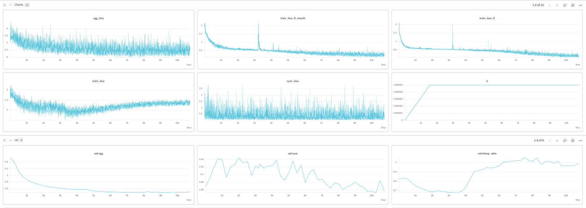
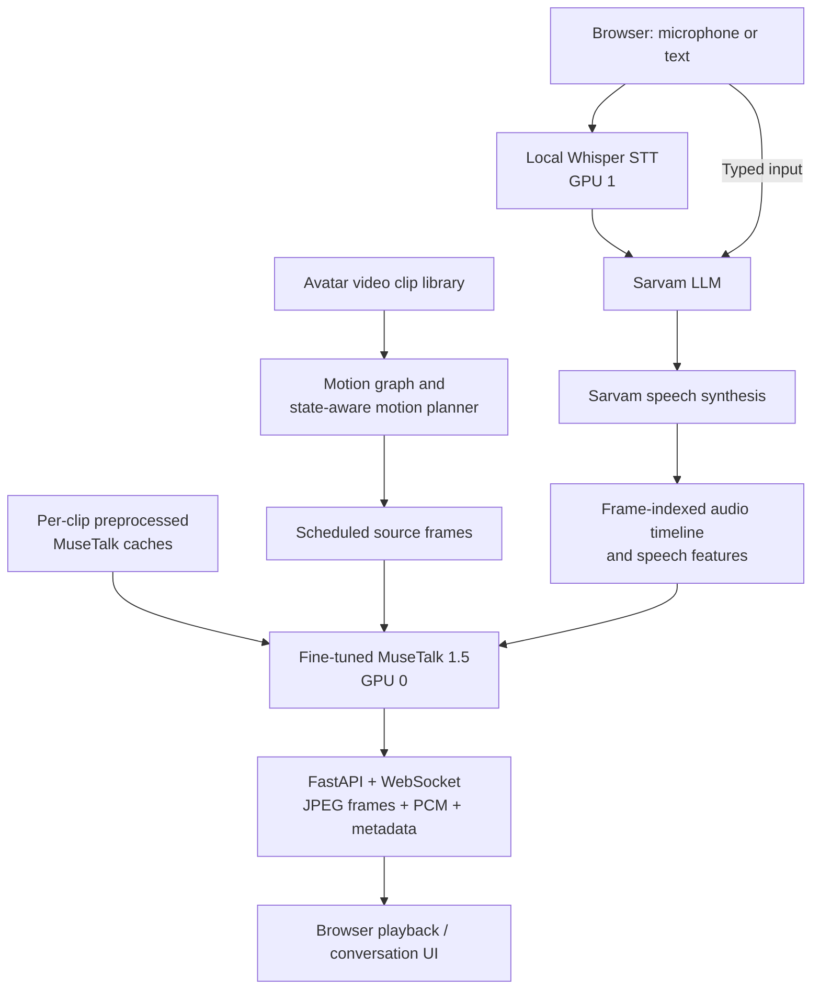
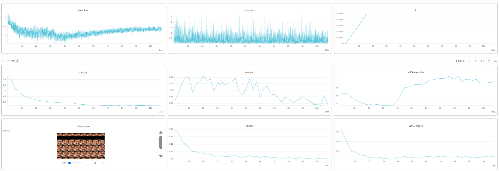

# Live Talking Avatar

### MuseTalk 1.5 fine-tuning + graph-aware motion + conversational AI

An interactive talking-avatar system built on **MuseTalk 1.5**, with a **custom fine-tuned lip-sync model**, a motion-graph-based video engine, local **Whisper speech recognition**, and **Sarvam LLM + TTS**. The application supports Hindi, Hinglish, and English conversations through a browser interface.

Instead of generating the entire person frame by frame, the system reuses a library of source-avatar video clips for natural head and body motion. A fine-tuned MuseTalk model synthesizes the mouth region to match generated speech. A continuous, frame-indexed audio/video pipeline keeps the two aligned as the motion planner changes clips.

> **Project status:** Research / development deployment. This repository contains source code and deployment scripts, **not** a ready-to-run model bundle. Model weights, avatar media, preprocessing caches, virtual environments, and credentials must be supplied separately. The 25 FPS figure is the pipeline's **target playback rate**, not a guaranteed real-time inference benchmark.

---

## Demos: base model vs. fine-tuned model

The following videos provide a **qualitative** comparison of the base MuseTalk model and the custom fine-tuned model.

| Base MuseTalk model | Fine-tuned MuseTalk model |
|:---:|:---:|
| [](https://youtube.com/shorts/tOwLj1tfOyc) | [](https://youtu.be/zMx4SahwwOM) |
| [Watch the base-model video](https://youtube.com/shorts/tOwLj1tfOyc) | [Watch the fine-tuned video](https://youtu.be/zMx4SahwwOM) |

**Fine-tuning visual result**



## How the system works



### 1. Subject-specific fine-tuning

- Start with the MuseTalk 1.5 lip-sync architecture and adapt its **UNet checkpoint** to the target avatar.
- MuseTalk-style inference uses a masked source-face representation, reference-face information, and audio features to predict a speech-driven face. The goal of fine-tuning is better adaptation to the target identity and its mouth appearance.
- The custom UNet is loaded at inference time from a local model directory. Large checkpoints are deliberately **not committed to Git**.
- The exact training data, sampling strategy, and loss weights are not reproduced by this README; refer to the training configurations and experiments for those details.

### 2. Motion graph rather than a static talking head

Lip-sync alone does not produce convincing full-body motion. This implementation uses a library of prepared avatar clips and a **graph of compatible motion segments** to choose source frames for the current conversational state.

- A motion planner chooses transitions between graph segments, with continuity and repetition considered in the scheduling logic.
- The playback timeline continues across segment boundaries; it does not restart when the avatar changes pose or clip.
- Approved joins can use short blends, and the scheduler tracks transitions for debugging.
- During speech, MuseTalk modifies the relevant source frames to match the synthesized voice. During silence, the pipeline can reuse original source frames, avoiding unnecessary lip-sync work.

The current deployment was prepared with **26 source clips and a 56-segment motion graph**. Those counts describe the existing local asset set, not media bundled with this repository.

### 3. Conversational speech pipeline

1. The browser captures a microphone utterance (or accepts typed text).
2. **Whisper STT** runs locally on the second GPU for speech transcription.
3. **Sarvam LLM** generates the assistant response.
4. **Sarvam TTS** synthesizes spoken audio, which is scheduled into the avatar audio timeline.
5. The conversation engine coordinates `LISTENING`, `THINKING`, `SPEAKING`, interruptions, and response completion.
6. The motion scheduler supplies source frames; **MuseTalk on GPU 0** produces the corresponding speech-driven face frames.
7. The server sends synchronized audio and video to the browser.

The conversation implementation also includes cancellation of interrupted turns, sentence-oriented TTS orchestration, and optional short spoken acknowledgements while a longer answer is being prepared.

### 4. Frame-aligned streaming

The streaming pipeline is designed around a **25 FPS presentation clock**. At **16 kHz audio**, each 40 ms video frame corresponds to **640 audio samples**. Each binary WebSocket packet carries:

```text
[16-byte header] [PCM16 audio] [JSON metadata] [JPEG frame]
       |               |              |              |
 frame number     audio segment    frame/state     video image
 + payload sizes                    information
```

Audio and video share a global frame index. The implementation uses bounded processing queues and per-client WebSocket send queues so a slow browser connection does not indefinitely block frame production.

**Playback modes:** The frontend includes a live-playback path and experimental complete-reply / presentation-style buffering logic. Buffering a whole answer before playback can improve perceived smoothness when rendering is slower than 25 FPS, **but it increases the delay before playback begins**. Actual throughput and latency depend on GPU capacity, model settings, clip resolution, and network conditions.

---

## Fine-tuning and training curves



The chart above shows a training run of approximately **10k+ steps**. It includes:

| Logged metric | What it helps monitor |
|---|---|
| `vgg_loss` and `val/vgg` | Perceptual / visual reconstruction behavior |
| `train_loss_D` and `train_loss_D_mouth` | Discriminator training behavior, including mouth-focused supervision |
| `train_loss` | Overall logged training objective; the curve is not necessarily directly comparable across changing adversarial dynamics |
| `sync_loss` and `val/sync` | Audio–visual synchronization loss trends |
| `val/sharp_ratio` | Sharpness-related validation diagnostic |
| `lr` | Learning-rate schedule |

**What the plot shows:** Validation VGG loss decreases substantially and then levels off. The sharpness-ratio metric rises during the later part of training, while synchronization-related values fluctuate. The overall training-loss curve is non-monotonic; that alone does not establish whether later checkpoints are better or worse. **Final quality must be judged using held-out audio, visual comparison, mouth synchronization, identity consistency, and temporal stability.**

A loss curve is **not proof of a particular latency, FPS, or lip-sync accuracy improvement**. The two demo videos above are included for qualitative assessment.

---

## Implementation highlights

| Area | Implementation |
|---|---|
| Lip synchronization | MuseTalk 1.5 with a custom fine-tuned UNet |
| Motion | Graph-aware segment selection using preprocessed avatar video clips |
| Speech recognition | Local Whisper service for Hindi / English |
| Language model | Sarvam LLM integration |
| Speech synthesis | Sarvam TTS, with sentence/chunk orchestration |
| Conversation | State machine, interruption/cancellation, optional acknowledgements |
| Transport | FastAPI + WebSocket with frame-indexed PCM, metadata, and JPEG |
| Frontend | Browser UI, microphone capture, conversation controls, metrics/debug view |
| Public demo access | Optional ngrok HTTPS tunnel to the avatar server |
| Deployment | Docker-hosted Linux environment, with separate GPU assignments |

### GPU and service layout

| Service | GPU | Local endpoint |
|---|---|---|
| MuseTalk avatar server | GPU 0 | `http://127.0.0.1:8782/` |
| Whisper STT | GPU 1 | `http://127.0.0.1:8310/docs` |
| ngrok tunnel | — | Forwards HTTPS traffic to port `8782` |

The tested deployment uses **two NVIDIA RTX A5000 GPUs**. Other GPU configurations may require changes to the launch scripts, batch size, or cache preparation.

## Repository structure

```text
Live-Talking-Avatar/
├── README.md
├── assets/                          # README images only
│   ├── training_curves.png          # Upload this training-chart screenshot
│   └── finetuning_result.png        # Upload the additional comparison image
├── avatar_a5000/
│   └── realtime/
│       ├── avatar_system/
│       │   ├── conversation/       # State machine, LLM / TTS orchestration
│       │   ├── motion/             # Motion graph, planner, scheduling
│       │   ├── lipsync/            # MuseTalk integration, audio timeline
│       │   ├── streaming/          # Frame pipeline, FastAPI/WebSocket
│       │   ├── frontend/           # Browser interface
│       │   ├── configs/            # Application configuration
│       │   └── scripts/            # Runtime helpers
│       ├── MuseTalk/               # MuseTalk-related source
│       └── musetalk_ft/            # Fine-tuning / STT-related source
└── avatar_a5000_deploy_kit/
    └── bin/
        ├── start_all.sh
        ├── stop_all.sh
        ├── 07_start_local_whisper.sh
        └── 08_start_avatar.sh
```

Some folders shown above require additional **local-only assets** at runtime. Model checkpoints, avatar clip files, generated lip-sync caches, virtual environments, and secrets are excluded from version control.

## Running the existing deployment

### Prerequisites

- Linux with NVIDIA GPU drivers and CUDA-compatible Python environments; the established setup runs inside the `vllm-dev` Docker container.
- The **fine-tuned MuseTalk checkpoint** and the required MuseTalk / VAE / audio model weights, restored to the paths expected by the configs.
- The original avatar clips, validated motion-graph data, and per-clip preprocessed MuseTalk caches.
- The existing MuseTalk and Whisper Python environments, or equivalent environments with compatible dependencies.
- A local `.env` containing the required **Sarvam credentials**. Do not commit or publish it.
- Optional: a configured ngrok installation for access outside the local server.

> **Not a one-command install:** A fresh Git clone alone will not start the avatar. First restore the private model assets, runtime environments, cache data, and any local symlinks used by your deployment.

From the root of the checked-out project inside the container:

```bash
# Start Whisper, MuseTalk and the optional ngrok tunnel
bash avatar_a5000_deploy_kit/bin/start_all.sh
```

The launcher derives its application paths relative to its own location. It starts the Whisper service first, then MuseTalk, then ngrok. Model initialization may continue after the launcher prints its status.

Verify local endpoints:

```bash
curl -s -o /dev/null -w "Avatar: %{http_code}\n" http://127.0.0.1:8782/
curl -s -o /dev/null -w "Whisper: %{http_code}\n" http://127.0.0.1:8310/docs
```

Stop the services:

```bash
bash avatar_a5000_deploy_kit/bin/stop_all.sh
```

Logs in the existing Docker environment:

```text
/opt/avatar_logs/avatar.log
/opt/avatar_logs/whisper.log
/opt/avatar_logs/ngrok.log
```

If running from Windows PowerShell, execute the corresponding script through the container:

```powershell
docker exec -it vllm-dev bash /workspace/musetalk-avatar-github/avatar_a5000_deploy_kit/bin/start_all.sh
```

## Security and asset management

- **Never commit:** `.env`, API keys, private keys, ngrok credentials, model checkpoints, avatar source media, generated caches, logs, or local virtual environments.
- The development deployment uses **local symlinks** for private assets. Those symlinks refer to paths on the original machine and are intentionally ignored by Git; they will not make another clone runnable.
- The source repository may be public, but do not expose a live ngrok endpoint or debugging APIs without assessing access controls and data privacy.
- Before publishing a new commit, review `git diff --cached --name-only` and perform a credential scan. `.gitignore` does not remove secrets embedded in ordinary source files or earlier commits.

## Credits and references

- **MuseTalk:** [TMElyralab/MuseTalk](https://github.com/TMElyralab/MuseTalk) — upstream talking-face/lip-sync project and model architecture.
- **Whisper:** [OpenAI Whisper](https://github.com/openai/whisper) — speech recognition model family.
- **Sarvam:** [Sarvam AI](https://www.sarvam.ai/) — LLM and speech-services integration.
- **This repository:** Custom avatar fine-tuning integration, motion-graph pipeline, conversational orchestration, streaming application, and deployment workflow.

Please follow the upstream projects' respective licenses, model terms, and attribution requirements. Third-party model weights and other external assets are **not redistributed** in this repository.

---

**A research-oriented, full-frame talking-avatar application built around fine-tuned lip synchronization, reusable natural motion, and conversational speech.**
